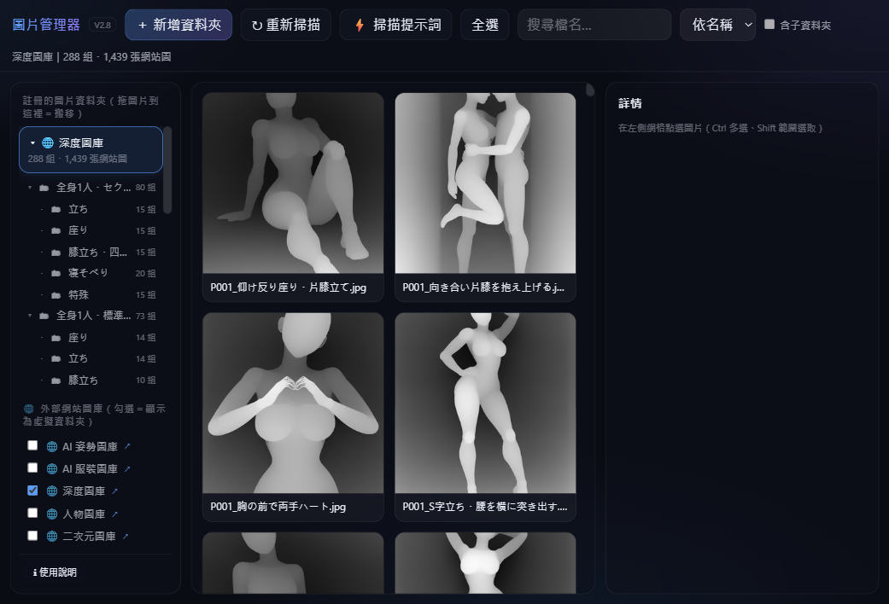
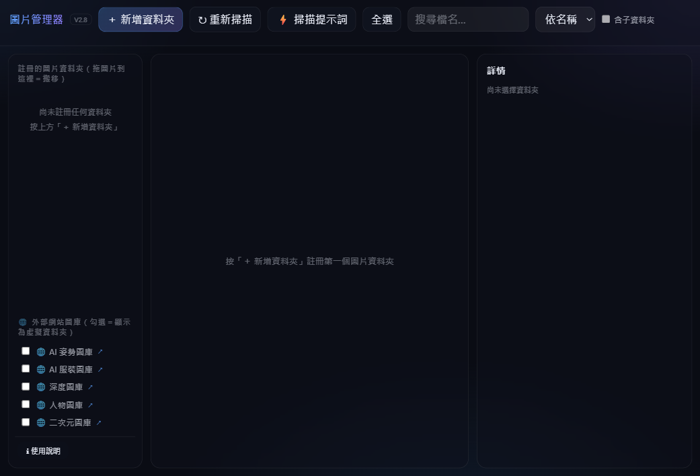
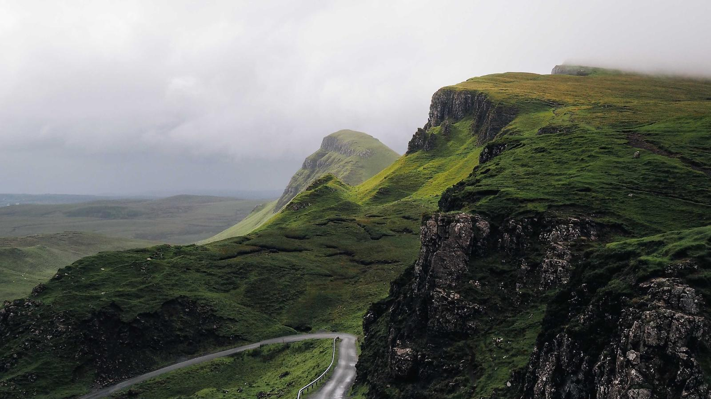
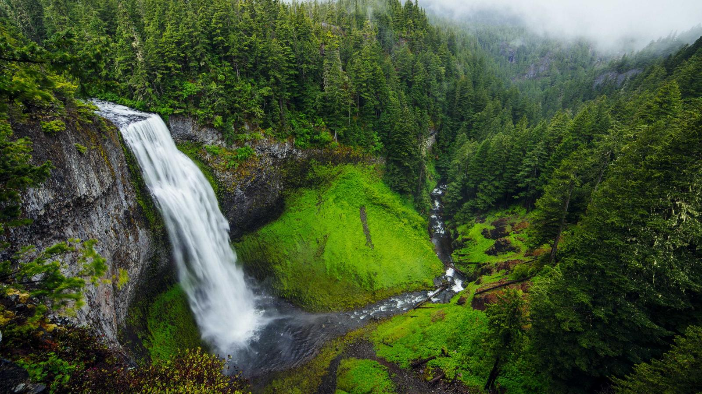
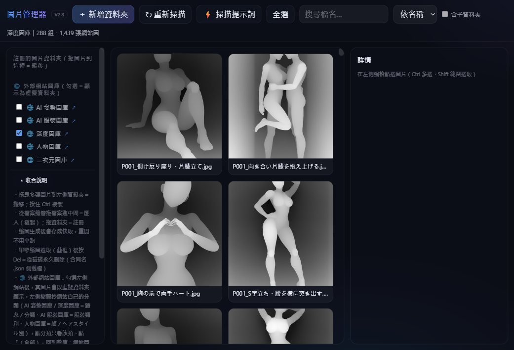

# 圖片管理器（Image Manager）

> 一個 **HTML 檔案**就等於整個圖片管理器——雙擊開瀏覽器直接用。免安裝、免註冊，圖片全程留在自己的硬碟上，不會上傳。

 

 

## ✨ 特點一覽

| | |
|---|---|
| 📦 **單一檔案** | 整個程式就是一個 `.html`，複製給朋友、放隨身碟都能用 |
| 🗂 **直接管理本機資料夾** | 縮圖、移動、刪除都作用在硬碟原檔，不用複製上傳 |
| 🖱 **拖曳整理** | 把圖片拖到左側資料夾＝搬移，按住 `Ctrl` ＝複製 |
| 🌐 **內建五個線上圖庫** | 深度、人物、姿勢、服裝、二次元，勾選即成虛擬資料夾 |
| 🏷 **拖搜尋詞建相簿** | 把搜尋詞拖到畫布中央，自動生成候選相簿 |
| 🔄 **自動檢查更新** | 開程式時跳視窗提醒，不更新照用舊版 |

 

## 🚀 快速上手（四步）

### 第 1 步：開檔案

到本 repo 根目錄下載 [**`Image_Manager_V1_glass.html`**](https://github.com/lono2023/imgmgr/raw/main/Image_Manager_V1_glass.html)，雙擊用 **Edge 或 Chrome** 開啟。第一次會看到這個畫面：

### 第 2 步：註冊圖片資料夾

點左上「**＋ 新增資料夾**」→ 選擇你放圖的資料夾 → 允許讀寫權限，縮圖立刻出現。
（也可以直接把資料夾從檔案總管**拖進程式視窗**，一次註冊好幾個。）

### 第 3 步：瀏覽與選取

畫面分成三欄：**左側**是資料夾樹、**中間**是縮圖、**右側**是詳情。

- 點一張圖 → 右側看大圖和檔名等詳情
- `Ctrl` ＋點＝多選、`Ctrl+A`＝全選、「含子資料夾」可跨層選
- 上方可搜尋檔名、依名稱／時間排序

*上圖是內建「深度圖庫」的瀏覽效果（288 套、1,439 張）。*

### 第 4 步：拖曳整理

- 拖多張圖片到左側資料夾 → **搬移**過去（按 `Ctrl` ＝複製）
- `Del` → 回收站；`Shift+Del` → 永久刪除（同名檔自動改檔名）
- 把**搜尋提示詞**拖到畫布中央 → 自動生成候選相簿

搬移後會顯示結果統計，失敗的檔案立刻回報、不會無聲消失。

 

## 🌐 內建線上圖庫

左下角「外部網站圖庫」勾選後，會在左側以 🌐 虛擬資料夾出現：

| 圖庫 | 內容 |
|---|---|
| 🌐 AI 姿勢圖庫 | 3D 人物姿勢參考 |
| 🌐 AI 服裝圖庫 | 服裝款式參考 |
| 🌐 深度圖庫 | 深度／立體人形圖（288 套） |
| 🌐 人物圖庫 | 人物照片參考 |
| 🌐 二次元圖庫 | 二次元畫廊 |

> ⚠️ 網站圖的語意是「**下載複製、非搬移**」：網站上的圖不會被移動，要整理請先匯入本機資料夾。

這類圖片就是適合用它管理的樣子（示範圖，免授權可自由使用）：

 

 

 

## 🔄 自動更新

每次開啟會比對線上版號：新版跳視窗提醒並附說明，**不更新也能繼續用**，不會被迫換檔。

 

## 📖 完整操作說明在程式裡

左下角「≡ 使用說明」展開就是全速查表：拖曳、複製、刪除、建相簿的每個手勢都在上面。

 

## ❓ 常見問題

**支援哪些瀏覽器？**
Edge、Chrome 或同核心的瀏覽器（需要檔案系統存取功能）；Firefox、Safari 暫時無法註冊本機資料夾。

**圖片會上傳到網路嗎？**
不會。除線上圖庫外，所有操作都在本機磁碟進行，也不用帳號。

**可以把 html 拷到別台電腦嗎？**
可以，雙擊就能用；之前註冊的資料夾在新電腦上重新授權一次即可。

**刪掉的圖找得回來嗎？**
`Del` 刪除走系統回收站；只有 `Shift+Del` 才是永久刪除。

 

## ⬇ 下載最新版

[**⬇ `Image_Manager_V1_glass.html`**](https://github.com/lono2023/imgmgr/raw/main/Image_Manager_V1_glass.html) — repo 根目錄隨時保持最新版本，下載覆蓋舊檔即完成手動更新。

 

## 📄 授權

程式本身為免費軟體，可自由轉貼分享。示範風景圖來自 [Picsum Photos](https://picsum.photos/)（Unsplash 授權，免標示出處、可商業使用）。
